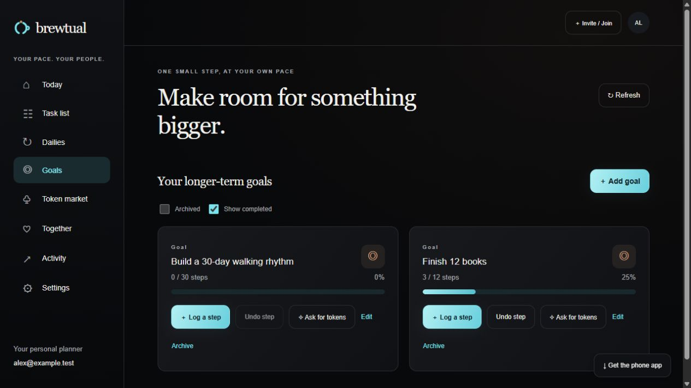

# Brewtual

### Small steps. Stronger together.

Brewtual is a personal planner that grows with your people. Organize your task list, build a rhythm with recurring Dailies, and make steady progress toward bigger Goals. Start on your own, then connect a partner or friend group when you want encouragement and shared rewards.

Whether you’re reading more, moving a little each day, or working toward a bigger goal, Brewtual gives you a reason to keep showing up—and someone to share the little wins with.



## A little accountability. A lot of possibility.

**Start with yourself.** Check off one-time tasks, schedule Dailies for the days that suit you, and track longer-term Goals one step at a time. You don’t need a partner to begin.

**Build with your person.** Connect a partner and use “Ask for tokens” on a task, Daily, or Goal. Once they approve the terms, future completions earn tokens toward thoughtful rewards.

**Grow with your friends.** Bring people into a friend circle with a shared invite code. Share progress, approve token requests, and offer rewards. Partner tokens, Group 1 tokens, Group 2 tokens, and their markets stay separate.

**Give milestones something to look forward to.** Offer a little promise, like coffee when a friend finishes a goal. Friends choose whether to join in, and you arrange the celebration together.

**Make the space your own.** Choose black Midnight with cyan and warm brown accents, bright Ocean, warm Dawn, or Aurora. The website adapts to desktop and phone screens, and you can add it to your phone’s home screen.

## Find your together

1. **Make yourself at home.** Create an account and pick a theme that feels like you.
2. **Find your rhythm.** Add tasks, choose your Daily schedule, and set goals. Start using your planner immediately.
3. **Invite your people when you’re ready.** Connect a partner or friend circle to unlock that space’s token market.
4. **Take the next small step.** Set a goal, log your progress, and give someone a little encouragement along the way.

No perfect streak required. Just your pace, your people, and a little progress.

## Run locally

You’ll need **Node.js 24.9+ within Node 24** and **Docker with Compose** for the local database. From the repository root:

```sh
npm ci
npm run local:setup
docker compose up -d
npm run db:generate
npm run db:migrate
npm run dev
```

Open [localhost:3000](http://localhost:3000), create an account, and sign in.

The setup command creates a root `.env` with a random development signing key and the default local database settings. If you already have a `.env`, it is preserved; check its database settings against [.env.example](.env.example). You can also use your own PostgreSQL database instead of Docker. Email delivery is optional for local signup.

For the separate Expo phone client, see the [mobile setup guide](mobile/README.md).

## Documentation

| Guide | What’s inside |
| --- | --- |
| [Development](docs/DEVELOPMENT.md) | Project structure, configuration, tests, and troubleshooting |
| [Deployment and phones](docs/DEPLOYMENT_AND_MOBILE_PLAN.md) | Vercel, database migrations, environment variables, and home-screen installation |
| [Personal planner and tokens](docs/PERSONAL_PLANNER.md) | Tasks, Dailies, Goals, approvals, and separate reward markets |
| [Friend circles and invites](docs/FRIEND_CIRCLES.md) | Connection codes, shared goals, cheers, milestone promises, and visibility |
| [Authentication](docs/AUTHENTICATION_PLAN.md) | Accounts, email verification, sessions, and account administration |
| [API contract](docs/BACKEND_CONTRACT.md) | Partner, habit, reward, and wallet endpoints |
