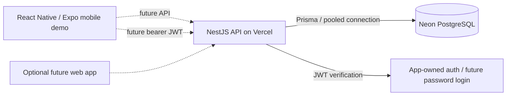

> Update, 17 October 2026: responsive web layout and provisioned email/password login are implemented. The client authenticates against the backend; habit API screens remain a separate fictional demo. Use the current [authentication guide](AUTHENTICATION_PLAN.md) and root README for setup. Earlier no-auth statements below describe the 14 October prototype. No deployment has been performed.

# Hosting and mobile plan

**Decision updated: 14 October 2026.** The immediate deliverable is the native React Native + Expo UI from `mobile/pair-habits-preview.html`, with persisted theme settings and local fictional demo state. It makes no API calls and has no sign-in/password gate. The existing NestJS API is a separate implemented slice; API integration comes later. Future production authentication is ordinary app-owned JWT auth, not Supabase. Flutter and a PWA are outside the current mobile slice.

The backend is already implemented as a separate slice, but it is not wired to this mobile UI. Keep it as the future API boundary; do not describe the prototype as a usable authenticated client. Vercel supports [NestJS applications directly](https://vercel.com/docs/frameworks/backend/nestjs), so a Next.js API rewrite is unnecessary.

Expo is tooling around React Native: the UI is a native Android/iOS application built from a shared TypeScript codebase, with optional Expo web preview. Current UI/theme settings are local only. Root commands are `npm run mobile`, `npm run mobile:web`, `npm run mobile:typecheck`, and `npm run mobile:export`. Reference: [Expo project creation](https://docs.expo.dev/get-started/create-a-project/).

## Authentication decision

No Supabase project or authentication provider is part of the plan. The future first private auth slice provisions two individual accounts, using email/password as the primary login and phone as an optional second identifier. Email/phone verification and password recovery are later work; unverified identifiers cannot establish recovery ownership. Use `AUTH_MODE=jwt`, backend-only `JWT_SECRET`, `JWT_ISSUER=pair-habits`, and `JWT_AUDIENCE=pair-habits-api`; retain `AUTH_MODE=local` only for local development/test. Production must fail closed until login/issuance exists and verified tokens resolve to existing users. Follow [the authentication plan](AUTHENTICATION_PLAN.md).

Password hashes should use Argon2id or scrypt; access JWTs should be short-lived, refresh credentials rotated/revocable, and mobile refresh tokens stored in platform secure storage. Never expose signing secrets through Expo public variables. Password login needs no email vendor. If later adding email verification/recovery, Resend lists 3,000 messages/month, 100/day and 3 domains on its free tier; two low-traffic accounts fit the listed volume, while domain purchase and verification are separate ([pricing](https://resend.com/pricing), [domain setup](https://resend.com/docs/dashboard/domains/introduction)). No provider account, API key, or emails were configured.

## Configured environment

The real database credentials are in ignored `backend/.env`. Committable templates contain no credentials. The supplied pooled Neon URL is used for runtime queries; its unpooled counterpart is used for schema migrations through Prisma's `directUrl`. Both retain TLS requirements. The pooled URL adds `connect_timeout=15`, `connection_limit=3`, and `pool_timeout=10` as an initial serverless connection budget. Revisit the connection limit against real load and database capacity. Reference: [Neon with Prisma](https://neon.com/docs/guides/prisma).

Both connections were verified and the existing initial migration was applied to the previously empty Neon database on 14 October 2026. The application tables and migration record are present; no demonstration accounts or habit data were seeded there. Automated integration tests still run against local PostgreSQL.

| Variable | Purpose | Where it belongs |
|---|---|---|
| `DATABASE_URL` | Pooled Neon connection used by the API | Backend only |
| `DATABASE_URL_UNPOOLED` | Direct connection for Prisma migrations | Backend/deployment migration tooling only |
| `NODE_ENV` | `development` locally, `production` on Vercel | Backend |
| `PORT` | Local API port, currently 3001; supplied by the host in deployment | Backend |
| `AUTH_MODE` | `local` for development/test; `jwt` for production verification | Backend |
| `LOCAL_AUTH_SECRET` | Existing random development token signing key | Local backend only |
| `JWT_SECRET`, `JWT_ISSUER`, `JWT_AUDIENCE` | App-owned JWT verification config (`pair-habits`, `pair-habits-api`) | Backend only; login issuer not implemented |
| `CORS_ORIGINS` | Exact browser client origins; empty is valid for a native-only app | Backend |
| `DB_TRANSACTION_MAX_WAIT_MS` | Maximum transaction connection wait, default 10 seconds | Backend |
| `DB_TRANSACTION_TIMEOUT_MS` | Maximum transaction duration, default 30 seconds | Backend |
| `TEST_DATABASE_URL` | Disposable integration-test database, currently local Docker Postgres | Local tests/CI only |
| `EXPO_PUBLIC_API_URL` | Future HTTPS API URL, ending with `/api/v1` | Mobile app; unused in demo slice |

The current UI is local and unauthenticated. The JWT verifier checks expiry, issuer, audience, and an existing database account; password login and token issuance are still required before a private release. Missing production configuration and invalid tokens are rejected. Do not put passwords or signing keys in the client.

Expo embeds `EXPO_PUBLIC_*` values in the app bundle, so these fields must contain only public client configuration. Database passwords and the development signing key stay in the backend. Reference: [Expo environment variables](https://docs.expo.dev/guides/environment-variables/).

## Vercel preparation

1. Import this repository with **Root Directory = `backend`**. Allow workspace source/dependency files outside that directory so the root npm lockfile and workspace dependencies are included.
2. Use Vercel's NestJS framework detection, **Node 24**, and the build command `npm run build`. `src/main.ts` follows Vercel's supported entrypoint convention. Reference: [Vercel Node versions](https://vercel.com/docs/functions/runtimes/node-js/node-js-versions).
3. Set database URLs and production values in the deployment environment. Production should use `NODE_ENV=production` and `AUTH_MODE=jwt` only after the JWT issuer/login slice exists; otherwise the API must fail closed. Keep local signing keys and test URLs out of deployment.
4. `backend/vercel.json` selects Singapore (`sin1`), matching the supplied Neon endpoint's `ap-southeast-1` region. Keeping API/database compute close reduces request latency. Reference: [Vercel regions](https://vercel.com/docs/regions).
5. Apply reviewed migrations once per target database with `npm run db:migrate` from the repository root. The build only generates the Prisma client and compiles; it does not silently mutate the production schema.
6. Set the eventual API URL in the mobile app and test sign-in, pair access, settlement, and redemption against the deployed API.

Vercel deployment was not performed. The mobile prototype remains local-only; no production auth issuer or deployment is configured.

## Scaling direction

Keep mobile clients dependent on the HTTP API contract rather than a particular host. The stateless API, relational data model, atomic token transactions, and persisted idempotency keys can be carried to a container host later. This avoids a mobile rewrite if hosting changes.

Before opening the app beyond private testing, add a shared rate-limit store, pagination for histories, and background delivery for notifications. The current in-memory rate limiter is per server instance, and there is no notification worker yet. Move large settlement backlogs to bounded jobs if measured usage calls for them. Native notification delivery will use the mobile notification workflow, replacing the old web-push installation flow in the UI brief.
