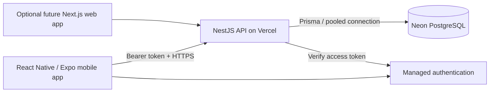

# Hosting and mobile plan

**Decision updated: 14 October 2026.** Keep the existing NestJS API, use Neon PostgreSQL, and build a separate React Native app with Expo for Android and iOS. Flutter is outside the current scope. This supersedes the earlier PWA-first client recommendation in the product/UI briefs.

The backend has already been implemented and tested. Keeping it is the fastest route to the first usable mobile app. Vercel supports [NestJS applications directly](https://vercel.com/docs/frameworks/backend/nestjs), so a Next.js API rewrite is unnecessary. Next.js remains an option for a future browser app or public project site; it would call the same API.

Expo is tooling around React Native: the mobile UI is a native Android/iOS application built from a shared TypeScript codebase. Start with development builds/Expo Go for the two-person walkthrough, then create installable builds. This task prepared `mobile/.env.example`; the mobile UI has not been scaffolded. Reference: [Expo project creation](https://docs.expo.dev/get-started/create-a-project/).

## Configured environment

The real database credentials are in ignored `backend/.env`. Committable templates contain no credentials. The supplied pooled Neon URL is used for runtime queries; its unpooled counterpart is used for schema migrations through Prisma's `directUrl`. Both retain TLS requirements. The pooled URL adds `connect_timeout=15`, `connection_limit=3`, and `pool_timeout=10` as an initial serverless connection budget. Revisit the connection limit against real load and database capacity. Reference: [Neon with Prisma](https://neon.com/docs/guides/prisma).

Both connections were verified and the existing initial migration was applied to the previously empty Neon database on 14 October 2026. The application tables and migration record are present; no demonstration accounts or habit data were seeded there. Automated integration tests still run against local PostgreSQL.

| Variable | Purpose | Where it belongs |
|---|---|---|
| `DATABASE_URL` | Pooled Neon connection used by the API | Backend only |
| `DATABASE_URL_UNPOOLED` | Direct connection for Prisma migrations | Backend/deployment migration tooling only |
| `NODE_ENV` | `development` locally, `production` on Vercel | Backend |
| `PORT` | Local API port, currently 3001; supplied by the host in deployment | Backend |
| `AUTH_MODE` | `local` for development, `supabase` for managed sign-in | Backend |
| `LOCAL_AUTH_SECRET` | Existing random development token signing key | Local backend only |
| `SUPABASE_URL` | Authentication project origin used for JWT verification | Backend; still needs a real project value |
| `CORS_ORIGINS` | Exact browser client origins; empty is valid for a native-only app | Backend |
| `DB_TRANSACTION_MAX_WAIT_MS` | Maximum transaction connection wait, default 10 seconds | Backend |
| `DB_TRANSACTION_TIMEOUT_MS` | Maximum transaction duration, default 30 seconds | Backend |
| `TEST_DATABASE_URL` | Disposable integration-test database, currently local Docker Postgres | Local tests/CI only |
| `EXPO_PUBLIC_API_URL` | HTTPS API URL, ending with `/api/v1`; LAN URL during development | Mobile app |
| `EXPO_PUBLIC_SUPABASE_URL` | Authentication project origin | Mobile app; pending |
| `EXPO_PUBLIC_SUPABASE_PUBLISHABLE_KEY` | Public authentication client key | Mobile app; pending |

Database hosting and authentication are separate services. The current backend verifies Supabase Auth access tokens; moving storage to Neon does not configure sign-in automatically. No Supabase project settings were supplied. Production must use managed sign-in; the backend rejects local token authentication in production. Do not add a Supabase service-role key to the mobile app; this backend does not need that key to verify JWTs.

Expo embeds `EXPO_PUBLIC_*` values in the app bundle, so these fields must contain only public client configuration. Database passwords and the development signing key stay in the backend. Reference: [Expo environment variables](https://docs.expo.dev/guides/environment-variables/).

## Vercel preparation

1. Import this repository with **Root Directory = `backend`**. Allow workspace source/dependency files outside that directory so the root npm lockfile and workspace dependencies are included.
2. Use Vercel's NestJS framework detection, **Node 24**, and the build command `npm run build`. `src/main.ts` follows Vercel's supported entrypoint convention. Reference: [Vercel Node versions](https://vercel.com/docs/functions/runtimes/node-js/node-js-versions).
3. Set the values shown in `backend/.env.vercel.example` in Vercel's environment settings. Fill both database URLs and the real authentication project URL; use `NODE_ENV=production` and `AUTH_MODE=supabase`. Keep development signing keys and local test URLs out of the deployment.
4. `backend/vercel.json` selects Singapore (`sin1`), matching the supplied Neon endpoint's `ap-southeast-1` region. Keeping API/database compute close reduces request latency. Reference: [Vercel regions](https://vercel.com/docs/regions).
5. Apply reviewed migrations once per target database with `npm run db:migrate` from the repository root. The build only generates the Prisma client and compiles; it does not silently mutate the production schema.
6. Set the eventual API URL in the mobile app and test sign-in, pair access, settlement, and redemption against the deployed API.

Vercel deployment was not performed in this task. Development configuration and deployment templates are prepared; authentication project values still need to be supplied.

## Scaling direction

Keep mobile clients dependent on the HTTP API contract rather than a particular host. The stateless API, relational data model, atomic token transactions, and persisted idempotency keys can be carried to a container host later. This avoids a mobile rewrite if hosting changes.

Before opening the app beyond private testing, add a shared rate-limit store, pagination for histories, and background delivery for notifications. The current in-memory rate limiter is per server instance, and there is no notification worker yet. Move large settlement backlogs to bounded jobs if measured usage calls for them. Native notification delivery will use the mobile notification workflow, replacing the old web-push installation flow in the UI brief.
