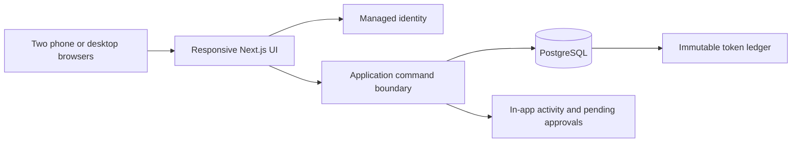

# Two-person habit and rewards app: product and technical plan

> **Current implementation decision, 14 October 2026:** The immediate client slice ports `mobile/pair-habits-preview.html` into native React Native + Expo and persists theme settings. Demo data is fictional/local; there is no API integration, login, or password gate. The existing NestJS API is a separate slice for future integration. Future auth uses app-owned JWTs and two provisioned accounts with individual passwords; email/password is primary and phone is an optional second identifier. Supabase is not part of the current decision. See [hosting and mobile plan](DEPLOYMENT_AND_MOBILE_PLAN.md) and [authentication plan](AUTHENTICATION_PLAN.md).

The product vision below is historical planning context; PWA-specific descriptions are not the current client implementation.

**Status:** decision draft for Sanket and partner  
**Prepared:** 3 October 2026  
**First audience:** exactly two adults in one private pair

## 1. What this plan takes from the source material

The pasted concept describes agreed goals, earned tokens, partner-defined rewards, and the unusual option to spend tokens to retire an agreed rule. The research PDF identifies relationship transactions and competing products as risks. The personal roadmap suggests protecting a 6–10 hour weekly budget and treating this as a bounded project. These documents are **inputs**, not instructions from either app user. In particular, the roadmap's “one weekend” limit and either research document's market-size and monetization claims are not accepted as requirements or verified forecasts.

The product decision here is to make something the two of you actually want to use, then create a portfolio-safe demonstration with fictional data. A company product would need separate discovery, permissions, reporting, and review of employment and privacy implications. It is not a toggle in this product.

## 2. Product promise and boundaries

**Promise:** “Agree on a goal, show up for it, and turn progress into something meaningful together.”

**The eventual product version supports:**

- One invitation-only pair, two individual accounts, shared visibility of agreed goals.
- Recurring habits with a weekly target, and one-off milestone goals for a larger objective.
- Partner approval of goal terms, reward terms, and optional rule buyout terms.
- Self-reported check-ins, transparent progress, deterministic token awards, a transaction history, redemption, and fulfillment status.
- A private mobile client with optional notifications after each person opts in.

**Deferred:** API integration, authentication screens, email/phone verification, recovery, notifications, friend groups, family/child accounts, employers, money, token purchases, leaderboards, AI coaching, proof photos, chat, and integrations. These require separate slices. The present UI is a local prototype walkthrough only.

### Core principles

1. **Mutual agreement before an obligation.** Either person can propose; the other must approve before terms become active.
2. **A token is an in-app accounting unit.** It is not money, cryptocurrency, or a transferable asset.
3. **Progress is supportive.** No public rankings, shame copy, automatic penalties, or default prices on affection/intimacy.
4. **The system is legible.** Every award and spend shows the exact rule, amount, and date behind it.
5. **Both people can leave.** Pausing a goal, archiving it, and unlinking the pair must be understandable; the app cannot enforce real-world favors.

## 3. Choose one technical stack

| | Option A — lean product build **(recommended)** | Option B — backend portfolio build |
|---|---|---|
| Client | Next.js App Router, React, TypeScript, responsive CSS with Tailwind and accessible headless primitives | Same UI stack, so the design work transfers |
| Server | Next.js Server Functions / Route Handlers for application commands and reads | NestJS REST API, organized as a modular monolith; Next.js handles the UI only |
| Identity | Supabase Auth | Supabase Auth; NestJS validates access tokens and pair membership |
| Data | Supabase PostgreSQL, migrations, RLS for browser-visible tables; narrow PostgreSQL functions for atomic ledger commands | Supabase PostgreSQL as a managed database, Prisma ORM/migrations; disable the Supabase Data API for app data and access it through NestJS |
| Hosting | Vercel for web app; Supabase for identity/database | Vercel for web app; a container web service for NestJS; Supabase for identity/database |
| Tests worth writing | Ledger and weekly award integration tests; one two-user browser flow | Same domain tests plus API authorization and contract tests |
| Main trade-off | Faster to ship, fewer deploys, but more business rules live in database functions and policies | Clear backend boundaries and stronger API/system-design story, with more code, hosting, and operational work |
| Best choice when | You want to use it soon and iterate with your designer partner | You explicitly want this app to demonstrate backend architecture and are willing to maintain a second service |

**Recommendation:** choose **A** for the private release. The roadmap already has a separate backend-heavy project, so this app can demonstrate sharp product judgment, careful authorization, and an auditable ledger without becoming another large system. The updated shortlist below explains the Neon variant of A and image-based hosting. Choose **B** only if the backend learning value is itself the priority. Do not build A and B in parallel.

**Why these choices are current and feasible:** Next.js supports App Router server mutations and a PWA manifest; Supabase supports Auth, PostgreSQL RLS, and callable database functions. NestJS provides controllers, services, guards, and modules for the separate-API option. Check live host pricing and quotas before deployment; no free-tier assumption is part of this plan. Sources: [Next.js App Router](https://nextjs.org/docs/app), [Next.js PWA guide](https://nextjs.org/docs/app/guides/progressive-web-apps), [Supabase RLS](https://supabase.com/docs/guides/database/postgres/row-level-security), [Supabase database functions](https://supabase.com/docs/guides/database/functions), [NestJS providers](https://docs.nestjs.com/providers), [Supabase JWT verification](https://supabase.com/docs/guides/auth/jwts), [Supabase Data API controls](https://supabase.com/docs/guides/api/securing-your-api).

### Deployment choice for a private app plus a public portfolio

Use one personal domain. Put a static portfolio at `yourdomain.tld` and link each project from it; give this app a subdomain such as `habits.yourdomain.tld`. Cloudflare can be the domain registrar and DNS provider, and can host the static portfolio on its free Pages plan. An app subdomain can point to Vercel while Cloudflare remains the DNS provider. DNS alone does not host the app. Subdomains are DNS records, not additional domain purchases.

For the two-person **non-commercial** app, Vercel Hobby plus Supabase Free is a sensible first deployment. Supabase Free currently includes a 500 MB PostgreSQL database and two active projects, but may pause projects after a week of low activity and does not include downloadable automatic backups; keep an independent export. Vercel Hobby is limited to personal non-commercial use. If the app becomes a paid offering, revisit hosting and plan eligibility first. Vercel Hobby also restricts private-repository collaboration: for Git deployments, the commit author must be the Hobby team owner. This matters if both partners commit code to a private repository.

For the portfolio itself, a static Astro site on Cloudflare Pages avoids paying for a server just to show project pages. A public case study should show fictional app data and link to a demo or video, while the real pair data remains behind sign-in. Register a personal domain when the portfolio is ready to publish; the domain has a recurring renewal cost, while first-level subdomains normally add no registration cost.

**AWS as a learning exercise:** Dockerize the application or API locally and use the Supabase CLI's container-based local stack. That gives you image, migrations, and deployment practice without making an always-on EC2 + RDS setup the home of a two-person app. A new AWS Free plan currently provides time-limited credits for up to six months; it is not a permanent free EC2/RDS host. An always-on paid account incurs separate instance, storage, and potentially public IPv4 charges. If you want AWS on the résumé, deploy a time-boxed copy with fictional data, document the architecture and cost estimate, then retire it. Use the [AWS Pricing Calculator](https://aws.amazon.com/aws-cost-management/aws-pricing-calculator/) for the chosen region before launching resources.

Current plan sources: [Cloudflare Registrar](https://developers.cloudflare.com/registrar/), [Cloudflare Pages limits](https://developers.cloudflare.com/pages/platform/limits/), [Cloudflare subdomain records](https://developers.cloudflare.com/dns/manage-dns-records/how-to/create-subdomain/), [Vercel Hobby](https://vercel.com/docs/plans/hobby), [Vercel private-repository collaboration](https://vercel.com/docs/deployments/troubleshoot-project-collaboration), [Supabase pricing](https://supabase.com/pricing), [Supabase local development](https://supabase.com/docs/guides/local-development), [AWS Free Tier](https://aws.amazon.com/free/).

### Updated stack shortlist: Neon and image-based deployment (3 October 2026)

The two options above describe architectural scope, not exclusive vendors. For the private app, Option A can use **Neon PostgreSQL + Neon managed Auth** in place of Supabase, with Drizzle migrations and all pair authorization and token commands on the server. Neon increased its Free database allowance on 2 October 2026 to **1 GB and 100 compute-unit hours per project per month, across up to 100 projects**; its Free backend also includes managed Better Auth. This is attractive when this app is one of several portfolio projects. Supabase remains a strong choice when its established Auth, RLS, storage, and browser data APIs would speed up delivery. Whichever database is chosen, perform awards and spending in database transactions with unique idempotency keys, and keep an independent data export.

| Deployment path | GitHub push flow | Free-tier and operating trade-off |
|---|---|---|
| Next.js + Neon or Supabase on Vercel Hobby | Run checks in GitHub Actions; Vercel builds and deploys from Git, or deploy through its CLI after checks | Lowest operations for a private non-commercial app. Vercel also supports a `Dockerfile.vercel`, but its managed function deployment is different from publishing an image to your own registry and having a container host pull it. |
| Next.js Docker image on Google Cloud Run + Neon | Actions tests, builds an image, pushes it to Artifact Registry, and deploys a new Cloud Run revision | Closest fit for an explicit image-publishing pipeline. Request-based instances can scale to zero; billing must be enabled, and registry, build, egress, or usage over free allowances can cost money. |
| Docker web service on Render Free + Neon | Render builds a Dockerfile from Git; a prebuilt image can also be deployed through its API | Simple container experience, but the free service sleeps after inactivity and waking it can take about a minute. Render Free Postgres expires after 30 days, so keep the database on Neon. |
| Cloudflare Workers/Pages + Neon | Git deployment through Cloudflare's build pipeline | Strong free alternative for an edge app and static portfolio; Next.js runs through its Workers adapter and runtime constraints, not as your Docker image. |

Firebase Spark is another no-card option with Auth, Hosting, and Firestore. Firestore's document model and per-read pricing are less natural for this product's relational approval history and auditable token ledger. Firebase SQL Connect gives PostgreSQL access, but its underlying Cloud SQL instance has a three-month trial followed by paid hosting. Choose Firebase if its client SDK, offline behavior, and realtime updates are the skills you specifically want to practice.

**Practical choice:** start with Next.js, TypeScript, Neon PostgreSQL and managed Auth, Drizzle, and Vercel Hobby if the priority is daily use plus several portfolio projects. Choose Supabase instead if its Auth/RLS workflow feels faster to the team. If building and publishing a Docker image is a deliberate learning objective, use the same application and database with Cloud Run. This keeps the app's domain model portable and makes the hosting exercise real. Keep the portfolio at the root domain and point the app subdomain to whichever host is selected through Cloudflare DNS.

Current vendor sources: [Neon Free update](https://neon.com/blog/neon-free-plan-1-gb-per-project), [Neon Auth](https://neon.com/blog/neon-auth-branchable-identity-in-your-database), [Supabase pricing](https://supabase.com/pricing), [Vercel Docker support](https://vercel.com/kb/guide/deploy-nodejs-on-vercel-with-docker), [Cloud Run pricing](https://cloud.google.com/run/pricing), [Cloud Run continuous deployment](https://docs.cloud.google.com/run/docs/continuous-deployment), [GitHub image publishing](https://docs.github.com/en/actions/tutorials/publish-packages/publish-docker-images), [Render Free](https://render.com/docs/free), [Cloudflare Next.js](https://developers.cloudflare.com/workers/framework-guides/web-apps/nextjs/), [Firebase pricing](https://firebase.google.com/pricing).

## 4. Shared application architecture

In Option A, `C` is a Next.js server command plus a PostgreSQL transaction for multi-row changes; the Supabase variant can use a restricted PostgreSQL function for this boundary. In Option B, `C` is the NestJS API. Neither client may write ledger rows or grant itself tokens. The pair ID is checked on every read and mutation. Use an in-app inbox as the durable record and opt-in Web Push for new approvals and reward requests. Store a push subscription per device and remove expired subscriptions. Timed habit reminders require a scheduler; Vercel Hobby cron runs at most daily and its invocation can vary within the selected hour.

### Domain objects

| Object | Essential fields and rule |
|---|---|
| Pair / membership | Pair ID, exactly two members, invite status, timezone; no cross-pair access |
| Goal | Owner, type (`recurring` or `milestone`), title, description, status, approved terms version, approver |
| Recurring terms | Active weekdays, required completions per Monday–Sunday week, tokens per qualifying week, start date |
| Milestone terms | Description of “done,” optional due date, fixed token award, partner approval on completion |
| Check-in | Goal ID, owner ID, local date, recorded time; one per goal per eligible day |
| Reward | Title, description, token cost, offered-by partner, approval state, fulfillment expectation |
| Rule / buyout | Plain-language rule, people affected, buyout cost, approved state, active/retired state |
| Ledger entry | Member, signed token amount, reason, source ID, idempotency key, timestamp; append-only |
| Redemption | Reward or rule ID, spender, cost snapshot, state, requested/fulfilled timestamps |

Store timestamps in UTC and the pair's timezone as an IANA timezone name. Display local dates based on that timezone. One pair-wide timezone avoids a completion counting in different weeks for each person. A later design can support per-person travel/timezones after usage shows it matters.

### Exact first-version mechanics

1. A proposed recurring goal has an owner, scheduled weekdays, required count, and weekly token award. The required count cannot exceed the number of scheduled days. The other partner approves it. Its first token-eligible week begins on the first local Monday after approval, so neither person has to make up scheduled days that already passed. A milestone goal becomes active on approval.
2. The owner checks in once on each scheduled local day. A check-in can be undone on the same local day. No backdating in the first version; corrections can be requested manually outside the app. Both members can see the check-in history.
3. At the end of a Monday–Sunday local week, qualifying means completed scheduled days **≥** the agreed required count. Each qualifying goal/week yields its agreed token amount once. A missed week earns zero and never creates a debt. Awarding happens when a member next opens the app after the week closes; a unique goal/week key and transaction make repeat visits safe.
4. A milestone owner marks it ready. The partner accepts or asks for revision. Acceptance creates one token award. This is the only first-version completion that needs an additional partner approval.
5. Edits to active goal terms create a new pending version. Old terms continue until the new version is approved; the change begins in the next week to avoid rewriting an in-progress award. Pausing or archiving also takes effect next week. A week with no active scheduled days cannot award tokens.
6. Reward and rule buyout terms require partner approval. Redeeming an approved reward deducts tokens immediately and creates a “requested” item for the offering partner to mark fulfilled. A buyout spends the agreed amount and retires the specific rule immediately; the confirmation screen states exactly what changes. Neither operation can make a balance negative.
7. Available balance is the sum of immutable ledger entries. Corrections are new compensating entries with a reason, never edits to history. All award and spend operations are atomic and idempotent.

These defaults are product decisions for a design and build starting point. If you want partner verification on every habit check-in, a different week start, or immediate goal edits, decide that before implementation because it changes the workflow and data model.

### Access and failure cases

- Authenticated members only see their pair. Invite links expire; acceptance only works for the invited account and a pair with one open seat.
- The proposer cannot approve their own proposal. The goal owner alone can check in; the partner alone can approve a milestone claim.
- Network retries cannot duplicate check-ins, weekly awards, or redemptions. A spend whose balance is insufficient returns a clear error and leaves data unchanged.
- A reward price change affects future redemptions only. Existing redemptions retain their cost snapshot.
- The interface displays pending settlement or offline state; it never shows a speculative token balance as final.
- Store only the goal details necessary for the product. Provide export and account/pair deletion paths before a public launch. A portfolio demo must use fictional seeded data, not your private activity.

## 5. Page map and navigation

| Route / view | Purpose | First-version actions |
|---|---|---|
| `/` | Public explanation and invitation entry | Understand the concept; sign in |
| `/sign-in` | Account access | Sign in; recover access |
| `/setup` | Pair creation or invite acceptance | Create pair; send/accept invite; choose timezone |
| `/today` | Primary daily use | See own due habits, check in, see partner progress and token balance |
| `/goals` | All active, pending, paused goals | Filter by person/status; open a goal |
| `/goals/new` | Propose a recurring or milestone goal | Enter terms; preview weekly earning rule; submit |
| `/goals/:id` | Goal details and history | See terms, calendar, edit proposal, milestone claim, pause/archive |
| `/approvals` | Agreement inbox | Review goal/reward/rule proposals and milestone claims |
| `/rewards` | Approved reward catalog plus rules | Propose reward, redeem, see rule buyouts |
| `/activity` | Wallet and fulfillment history | Audit every earned/spent token; track outstanding rewards |
| `/settings` | Pair and account settings | Timezone, invite status, notifications, export/delete, sign out |

On phones, primary navigation is **Today, Goals, Rewards, Activity**. A profile control opens Settings; Approvals appears as a prominent badge/action from Today and relevant detail screens. Desktop uses the same structure with a side navigation. A public marketing page is useful for a portfolio launch but should not delay the private app.

## 6. Suggested delivery sequence

| Slice | Reviewable outcome |
|---|---|
| 0. Clickable design | Two-user walkthrough from proposed goal to earned and spent tokens; all core states specified |
| 1. Private vertical slice | Sign-in, pairing, one recurring goal, approval, check-in, weekly award, ledger, one reward redemption |
| 2. Complete personal v1 | Milestone goal, reward fulfillment, rule buyout, history, installable PWA, opt-in Web Push for partner actions, errors/empty states, responsive and accessibility pass |
| 3. Portfolio launch | Public explanation, fictional demo data, README with architecture and trade-offs, basic privacy and account-control flows |
| 4. Discovery, if desired | Interview real pairs; then choose one adjacent market based on observed use, rather than assuming company demand |

**A useful validation question after a few weeks:** Are the two of you still creating goals, checking in, and redeeming rewards voluntarily, and do the rewards feel encouraging rather than transactional? This matters more to the first decision than market-size estimates in either attached research document.

## 7. Decisions for the two of you

1. Pick Option A or B. A is recommended for the private launch.
2. Pick the pair timezone and whether the Monday–Sunday week fits your routine.
3. Decide whether all recurring habits use self-report, or some require partner verification; this draft uses self-report after terms are approved.
4. Set an initial token scale (for example, small habits earn 1–3 per qualifying week) and cap prices so rewards feel reachable. These numbers should be agreed together, not hard-coded globally.
5. Choose a temporary name and visual direction with your designer partner. Product rules can be designed before branding is final.
