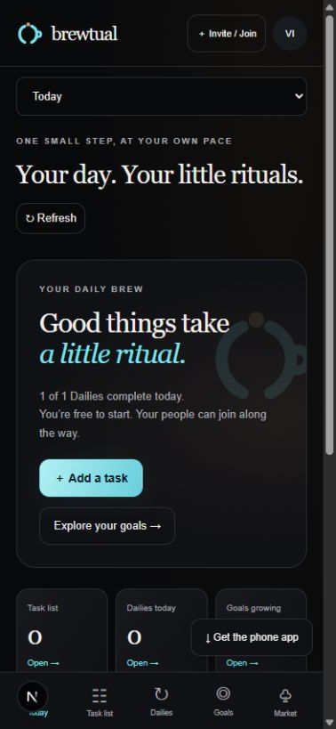

# Brewtual verification — October 30, 2026

## Planner incident

The configured hosted database had only the initial, password-auth, and email-verification migrations. Circle and personal-planner tables were absent. Applied `20261023170000_friend_circles` and `20261023190000_personal_planner` successfully, preserving existing records. Read-only calls to both planner service queries then succeeded using a random nonexistent account ID.

The readiness endpoint now checks planner/circle tables and enum values, so a reachable but unmigrated database no longer reports ready. Unexpected API failures log a safe Prisma error code without exception messages or metadata.

## Fixes

- Concurrent partner-code joins return a conflict instead of an internal server error when membership uniqueness is contested.
- Session restoration displays loading until refresh completes.
- A dismissed install prompt is consumed once; failed prompts fall back to platform instructions.

## Verification

- Server unit/API suite: 94 tests passed.
- Web transport/component suite: 15 tests passed. Includes solo and connected navigation, creation of tasks/Dailies/Goals, edit, completion, archive, token requests, market approvals, redemption retry keys, and mutation-error recovery.
- PostgreSQL integration suite: 14 tests passed against a dedicated local PostgreSQL 16 database, using isolated schemas. Includes real migrations, authenticated planner reads before/after pairing, missing-table readiness, account/session flows, access control, separate balances, concurrent awards/spending, and append-only ledgers.
- Production build and actual Next.js page/API smoke test passed with Node 24.22.1. Covers home, verification, health, authentication validation, and database-outage behavior.
- Mobile transport/mapping suite: 9 tests passed; mobile TypeScript check passed.

## Remaining limits

Component tests exercise actual handlers with mocked API responses. Physical-phone installation and real SMTP delivery remain unverified. Readiness checks table existence and enum values, not every column. Source changes still need deployment; the database migration is already applied.

Local PostgreSQL was installed in Ubuntu under WSL because the Docker engine was unavailable. Tests use the dedicated `brewtual_test` database and remove their isolated schemas.

## Signed-in browser walkthrough

Used a disposable local account in a separate `visual_20261030` schema. Visited Today, Task list, Dailies, Goals, Token market, Together, Activity, and Settings. Created and completed a task with a private note; created and checked off a recurring Daily; created a three-step Goal and logged one step. Created a friend circle and inspected its empty goal state. Solo Market and Activity showed their connection requirement. Reload restored the session, Daily completion, and Goal progress.

Inspected Today and Settings at 393 × 851 pixels. Mobile section selection and bottom navigation were available, and the main controls remained visible. This viewport check does not reproduce Android Chrome or installed-app behavior. Multi-account market interactions remain covered by automated tests rather than this visual walkthrough.

## Android installation preparation

On the deployed HTTPS site, the installation-help button displayed Android Chrome instructions. The manifest, service worker, both PNG icons, and offline fallback all returned HTTP 200 with appropriate content types; the manifest requests standalone display and starts at `/`.

Physical-device check to complete: open `https://brewtual.vercel.app` in Chrome, choose the menu's Install app or Add to Home screen action, launch the resulting icon, sign in, close and reopen, and confirm the session and progress restore. Disconnect briefly to check the reconnect page, then reconnect and refresh. No physical Android device was available to control in this session.
